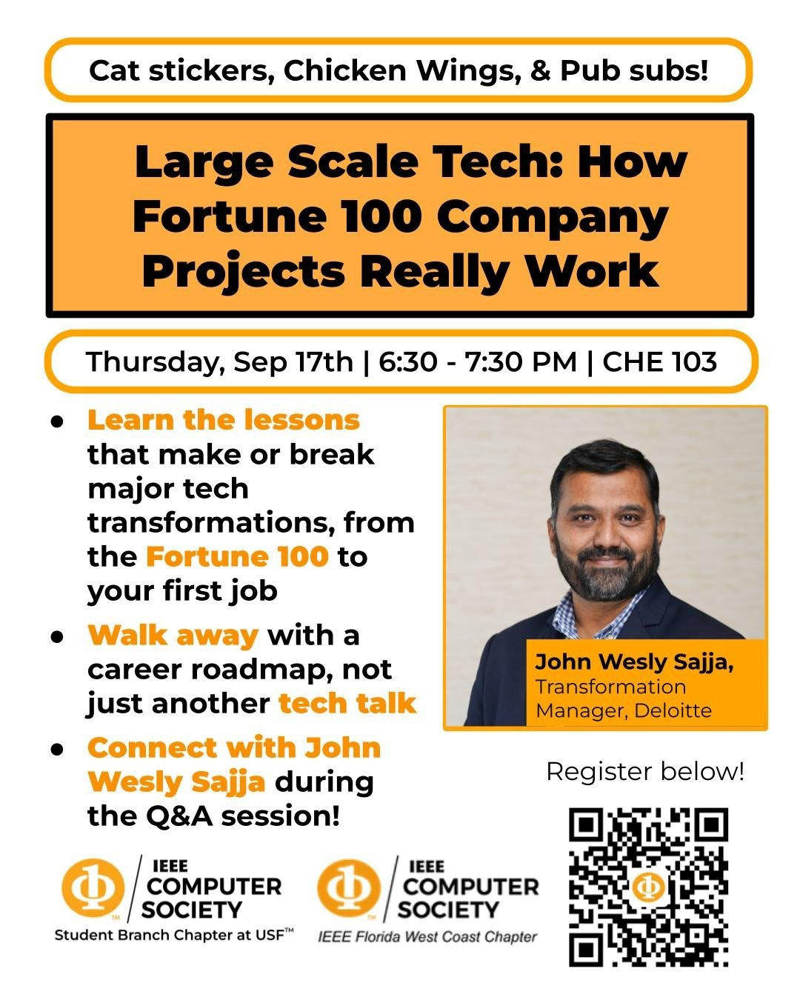

# Large Scale Tech: How Fortune 100 Company Projects Really Work

A guest talk by John Wesly Sajja, Transformation Manager at Deloitte and IEEE Senior Member, hosted by the IEEE Computer Society student branch chapter at the University of South Florida with the IEEE Florida West Coast Chapter.

Thursday, September 17, 2026, 6:30 to 7:30 PM, CHE 103.

## What the talk covered

- The six phases of a Fortune 100 modernization program: discovery, data prep, mock conversions, rehearsals, cutover, and hypercare.
- Five lessons from the field. Data work starts months before cutover, go-live runs from a command center, hypercare needs exit criteria set in advance, stakeholder alignment matters more than perfect technology, and AI now does reconciliation and validation work that used to take whole teams.
- What these programs cost and how long they run, typically 12 to 36 months from kickoff to go-live.
- Tools to learn for each part of the job, such as SAP Datasphere, Collibra, ServiceNow, Splunk, and UiPath.
- Entry-level job titles to search for, how the career grows over 15 years, and six steps to start on this semester.

## In this repo

- `USF_IEEE_09172026.pdf`, the full slide deck from the talk.

## Links

- [Event page](https://www.ieeecsusf.com/events/2010251)
- [John Wesly Sajja on LinkedIn](https://www.linkedin.com/in/johnweslysajja/)
